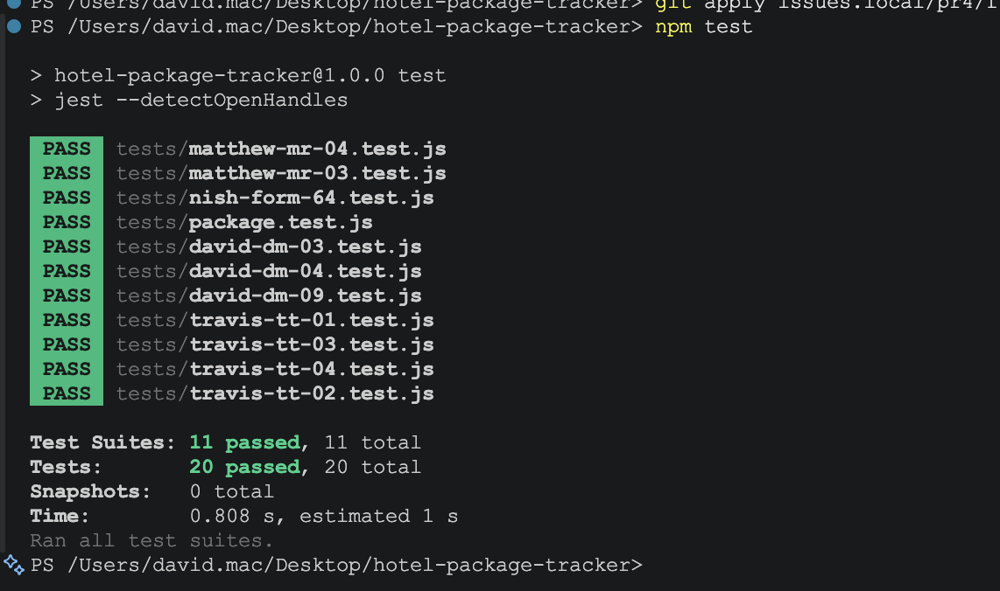

# PR4 Team Report

**Team:** Group 15
**Members:** Nish, Travis, Matthew, David

Each member edits only their own file (`<firstname>_<lastname>.md`). Team sections are shared. Fill in the ones marked **TODO**.

---

## 1. Bug Triage Table

One row per failing test. Owners and severity/priority are proposals until the team confirms them on the board.

| Test name | Bucket | Issue link | Severity | Priority | Owner | Status |
|---|---|---|---|---|---|---|
| travis-tt-02: PickupRecord stores signature data and pickup time | Missing feature | #83 | Medium | Medium | Travis | Open |
| travis-tt-03: scanResult rejects empty scanned text | Missing feature | #84 | Medium  | Medium | Travis | Open |
| travis-tt-04: Front desk staff can retrieve complete package information | Missing feature | #85 | Medium | Medium | Travis | Open |
| DM-03: POST returns 500 instead of 400 when carrier is missing | Code bug | #71 | Medium | Medium | David | Fixed in PR #89 |
| DM-04: Whitespace-only trackingNumber returns 500 instead of 400 | Code bug | #72 | Medium | Medium | David | Fixed in PR #89 |
| DM-07: Duplicate tracking number is accepted and saved twice | Missing feature | #73 | Medium | Medium | David | Open |
| DM-08: POST accepts requests with no staff credentials | Missing feature | #74 | High | Medium | David | Open |
| DM-09: Malformed JSON returns an HTML stack trace | Code bug | #75 | Low | Low | David | Fixed in PR #89 |
| DM-10: No field to tell apart guests with the same name | Missing feature | #76 | Medium | Low | David | Open |
| MR-03: GET /api/packages/search returns 500 instead of 400 when q is missing | Code bug | #90 | Medium | Medium | Matthew | Open |
| MR-04: Search treats special characters as a pattern | Code bug | #91 | Medium | Medium | Matthew | Open |

**Bucket definitions used:** Code bug = the test is correct and the code is wrong. Test bug = the code is correct and the test is wrong. Missing feature = the original team never built it. The instructor confirmed that building a missing feature counts as a fix for the bug-fix requirement.

**TODO:** David and the rest of the team must add their own failing tests to this table. Nobody has run the full suite against their tests yet.

---

## 2. Regression Log

**TODO:** After each merge to `main`, run `npm test` and record the date, the PR merged, and the result. If a fix breaks an old test, log the fix, the test that broke, and how it was resolved.

| Date | PR merged | Full suite result | Regressions |
|---|---|---|---|
| Nov 22 | #87, #88, #89 | `npm test` on `main` at `2e84b28`: 8 files, 13 of 13 tests passed | None |

---

## 3. Final Test Run

**TODO:** After the freeze on Thu Nov 19, run `npm test` on `main`, save the output as `screenshots/final_test_run.png`, and embed it here.

**Still failing at freeze:** TODO (one line per test, with a reason).

---

## 4. Feature Decision

**TODO:** Choose one feature. Candidates from the missing-feature bucket: PickupRecord signature capture (#83), scanResult parsing (#84), PackageInfo retrieval (#85), a duplicate tracking number check (#73), staff login (#74), or a room number on the package record (#76).

- **Feature name:** TODO
- **User story:** As a ___, I want ___, so that ___.
- **Why we chose it:** TODO
- **Owners:** TODO
- **Test case 1:** TODO
- **Test case 2:** TODO
- **Feature Issue:** TODO (filed with the `feature` label)

---

## 5. Board Snapshot

**TODO:** Embed `screenshots/board.png` after bug Issues are moved to Done.

---

## 6. Sprint Summary

**TODO:** One paragraph covering what is fixed, what is still broken, and what to look at first next sprint.
