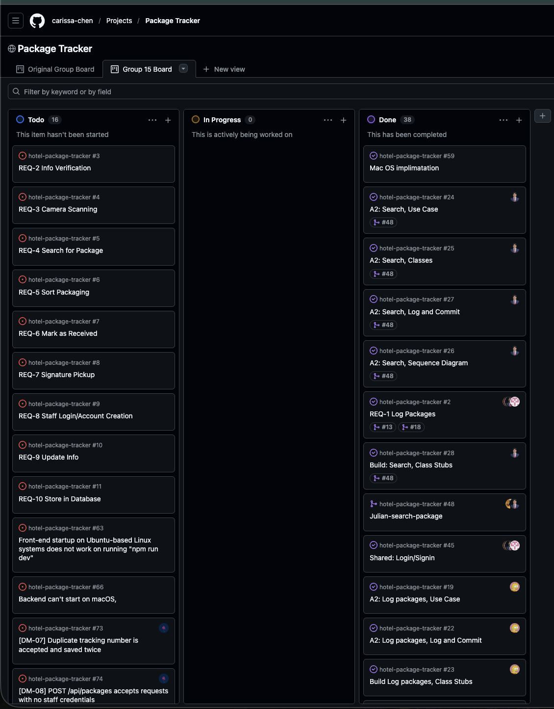

# PR4 Team Report

**Team:** Group 15
**Members:** Nishanth Mahendran, Travis Trinidad, Matthew Rohrer, David Martindale

Each member edits only their own file (`<firstname>_<lastname>.md`). Team sections are shared.

---

## 1. Bug Triage Table

One row per failing test.

| Test name | Bucket | Issue link | Severity | Priority | Owner | Status |
|---|---|---|---|---|---|---|
| travis-tt-02: PickupRecord stores signature data and pickup time | Missing feature | #83 | Medium | Medium | Travis | Fixed in PR #87 |
| travis-tt-03: scanResult rejects empty scanned text | Missing feature | #84 | Medium | Medium | Travis | Fixed in PR #87 |
| travis-tt-04: Front desk staff can retrieve complete package information | Missing feature | #85 | Medium | Medium | Travis | Fixed in PR #87 |
| DM-03: POST returns 500 instead of 400 when carrier is missing | Code bug | #71 | Medium | Medium | David | Fixed in PR #89 |
| DM-04: Whitespace-only trackingNumber returns 500 instead of 400 | Code bug | #72 | Medium | Medium | David | Fixed in PR #89 |
| DM-07: Duplicate tracking number is accepted and saved twice | Missing feature | #73 | Medium | Medium | David | Open |
| DM-08: POST accepts requests with no staff credentials | Missing feature | #74 | High | Medium | David | Open |
| DM-09: Malformed JSON returns an HTML stack trace | Code bug | #75 | Low | Low | David | Fixed in PR #89 |
| DM-10: No field to tell apart guests with the same name | Missing feature | #76 | Medium | Low | David | Open |
| matthew-mr-03: GET /api/packages/search returns 500 instead of 400 when q is missing | Code bug | #90 | Medium | Medium | Matthew | Fixed in the final PR4 pull request (fix by David) |
| matthew-mr-04: Search treats special characters as a pattern | Code bug | #91 | Medium | Medium | Matthew | Fixed in the final PR4 pull request (fix by David) |
| nish-form-64: Package form shows success even when saving fails | Code bug | #64 | Medium | Medium | Nishanth | Fixed in PR #88 |
| `npm run lint` fails with 59 ESLint errors | Code bug | #65 | Low | Low | Nishanth | Fixed in PR #92 |

**Bucket definitions used:** Code bug = the test is correct and the code is wrong. Test bug = the code is correct and the test is wrong. Missing feature = the original team never built it. The instructor confirmed that building a missing feature counts as a fix for the bug-fix requirement.

---

## 2. Regression Log

No regressions found. The full suite was run on `main` on Nov 22, after the merges listed below.

| Date | PR merged | Full suite result | Regressions |
|---|---|---|---|
| Nov 22 | #87, #88, #89 | `npm test` on `main` at `2e84b28`: 8 files, 13 of 13 tests passed | None |
| Nov 22 | #92, #93, #94, #95 | `npm test` on `main` at `ce1564e`: 8 files, 13 of 13 tests passed | None |

---

## 3. Final Test Run

`npm test` on Nov 22 with all PR4 work applied (the code merged to `main` in the final PR4 pull request): 11 test files, 20 of 20 tests passed.

**Still failing:** None.

---

## 4. Feature Decision

- **Feature name:** Shared cloud database on MongoDB Atlas
- **User story:** As a front desk staff member, I want package records stored in one shared cloud database, so that every desk computer shows the same packages.
- **Why we chose it:** It builds on CR-1 from System Map Part 5 (save package records) and on the original team's open requirement REQ-10, Store in Database (#11). Today `server.js` falls back to `mongodb://localhost:27017`, so each computer keeps its own separate records and each teammate had to install MongoDB locally before the server would start. One Atlas database removes that setup step and gives every user the same data.
- **Owners:** David: Atlas cluster and connection string. Nishanth: loading `MONGO_URI` from a `.env` file that stays out of the repo. Matthew: README setup steps. Travis: automated tests for the feature.
- **Test case 1:** With `MONGO_URI` set to the Atlas connection string, `npm start` prints "Connected to MongoDB", and `POST /api/packages` with a valid package returns HTTP 201.
- **Test case 2:** A package logged from one computer appears in `GET /api/packages` on a second computer that uses the same connection string.
- **Feature Issue:** #11, labeled `feature`

---

## 5. Board Snapshot

---

## 6. Sprint Summary

This sprint the team fixed ten issues: missing-carrier and whitespace validation and JSON error responses in the package API (#71, #72, #75), the PickupRecord, scanResult, and PackageInfo methods that were empty stubs (#83, #84, #85), the form that reported success when a save failed (#64), the lint configuration (#65), and two search bugs found late in the sprint, a missing search term and special characters treated as a pattern (#90, #91). The full suite is 11 files and 20 tests, all passing. Still broken: the startup issues #63 and #66. Duplicate tracking numbers (#73), staff login (#74), and a room number on the record (#76) are missing features that we did not choose for the final sprint. Two process gaps remain: the search fixes for #90 and #91 were merged without before and after screenshots, and not every pull request had a teammate's approval before it merged. Next sprint, look first at the database connection in `server.js`, because the final feature replaces the local MongoDB fallback with a shared Atlas database.
