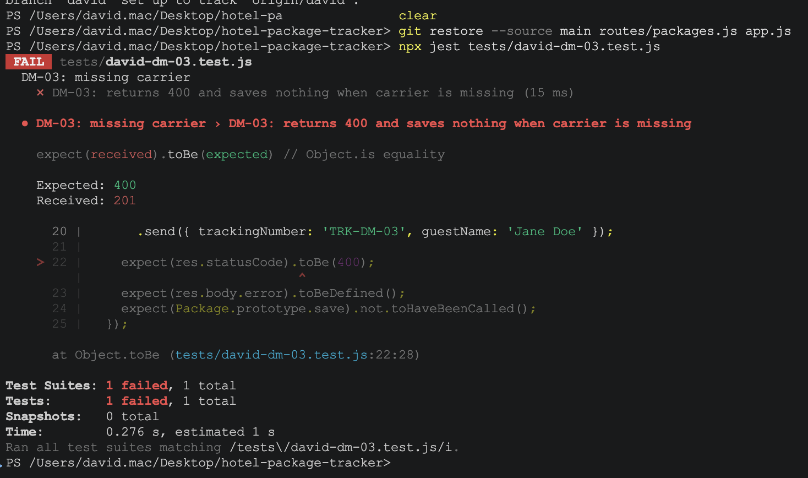
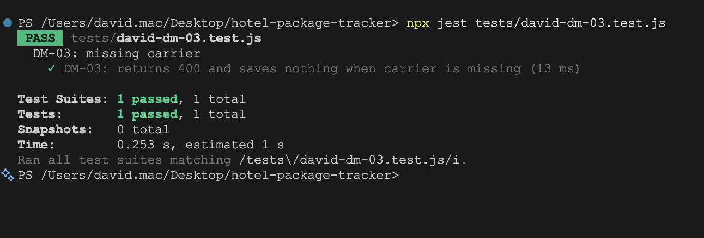
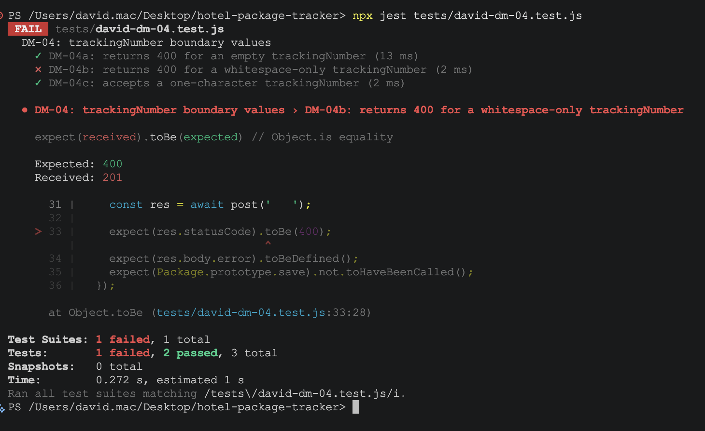
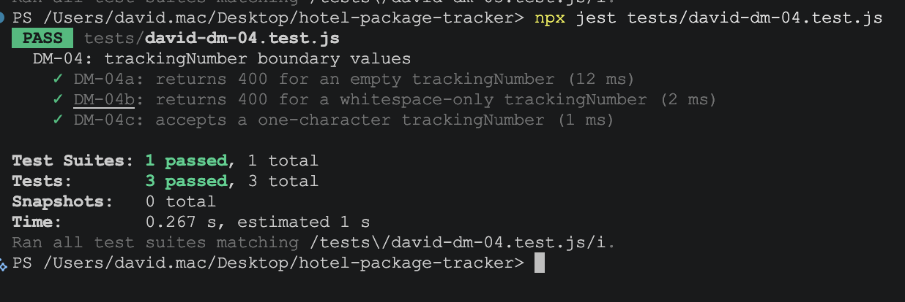
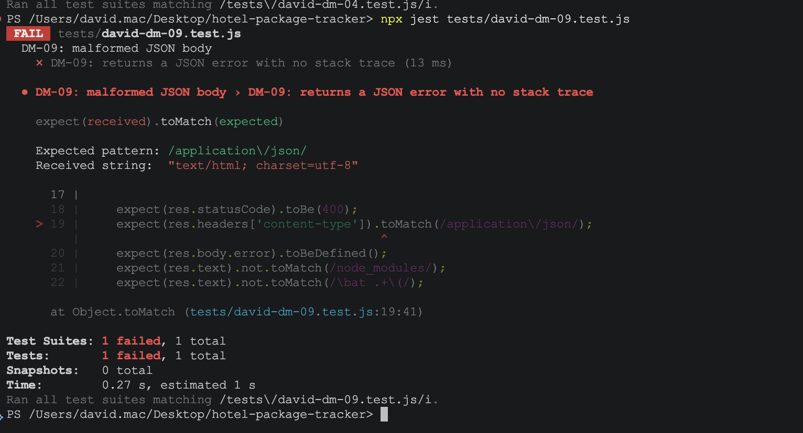
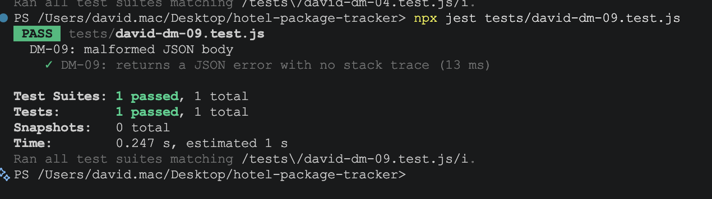

# David Martindale

**Team:** Group 15
**Branch:** `david`

All three fixes are in one pull request. The link is defined once, on the last line of this file.

---

## Bug fix 1: Issue #71, missing carrier returns 500 instead of 400

- **Issue:** [#71](https://github.com/carissa-chen/hotel-package-tracker/issues/71) (DM-03)
- **PR:** [#89][pr]
- **Test:** `tests/david-dm-03.test.js`
- **Before:** 
- **After:** 
- **Bucket:** Code bug. The test asks for what the requirement says (carrier is one of three required fields), and the check in `router.post('/')` named only `trackingNumber` and `guestName`.

---

## Bug fix 2: Issue #72, whitespace-only trackingNumber returns 500 instead of 400

- **Issue:** [#72](https://github.com/carissa-chen/hotel-package-tracker/issues/72) (DM-04)
- **PR:** [#89][pr]
- **Test:** `tests/david-dm-04.test.js`
- **Before:** 
- **After:** 
- **Bucket:** Code bug. The route checked the raw value, so three spaces passed the check and failed later in the schema, which trims before it validates.

---

## Bug fix 3 (optional): Issue #75, malformed JSON returns an HTML stack trace

The assignment requires two fixes per student. I did this third one because the fix is small and it removes a stack trace from every bad request.

- **Issue:** [#75](https://github.com/carissa-chen/hotel-package-tracker/issues/75) (DM-09)
- **PR:** [#89][pr]
- **Test:** `tests/david-dm-09.test.js`
- **Before:** 
- **After:** 
- **Bucket:** Code bug. `app.js` had no error-handling middleware, so Express's default handler answered with an HTML page and a stack trace.

---

## What changed

- `routes/packages.js`: the required-field check now covers `carrier` and treats a blank or whitespace-only value as missing. Fixes #71 and #72.
- `app.js`: one error-handling middleware returns request errors as JSON with an `error` field. Fixes #75.

The tests mock the package model, so the unfixed route returns 201 in the "before" runs of DM-03 and DM-04. Against a real database the same requests return 500. Both are wrong, and the tests expect 400.

## Neighbors checked

- The full suite passes with the fixes: 8 test files, 13 tests. I ran it again on `main` after PR #89 merged, with the same result.
- Against a real MongoDB, a valid POST still returns 201, padded values are still trimmed, a numeric tracking number is still accepted, and `GET /api/packages` and `/api/packages/search` still return the saved records.

## AI disclosure

- Claude (Anthropic) ran the test cases that found these bugs last sprint.
- Claude wrote the three test files and the fixes in `routes/packages.js` and `app.js`, and checked them against a real database.
- Claude drafted this file and my rows of the team report.
- I ran each test before and after the fix on my machine, took the screenshots, reviewed the changes, and opened the pull request.

[pr]: https://github.com/carissa-chen/hotel-package-tracker/pull/89
