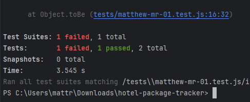

# Matthew Rohrer

**Team:** Group 15
**Branch:** `matthew-rohrer-general`

---

## Bug fix 1: Issue #90, GET api/packages/search returns 500 instead of 400 when querry is missing

- **Issue:** [#90](https://github.com/carissa-chen/hotel-package-tracker/issues/90)
- **PR:** 
- **Test:** `tests/matthew-mr-01.test.js`
- **Before:** 
- **After:** 
- **Bucket:** Code bug.

---

## Bug fix 2: Issue #91

- **Issue:** [#91](https://github.com/carissa-chen/hotel-package-tracker/issues/91)
- **PR:** 
- **Test:** 
- **Before:** 
- **After:** 
- **Bucket:** Code bug.

---

## AI Disclosure

- Issues #90 and #91 were found by David Martinsdale using Claude.