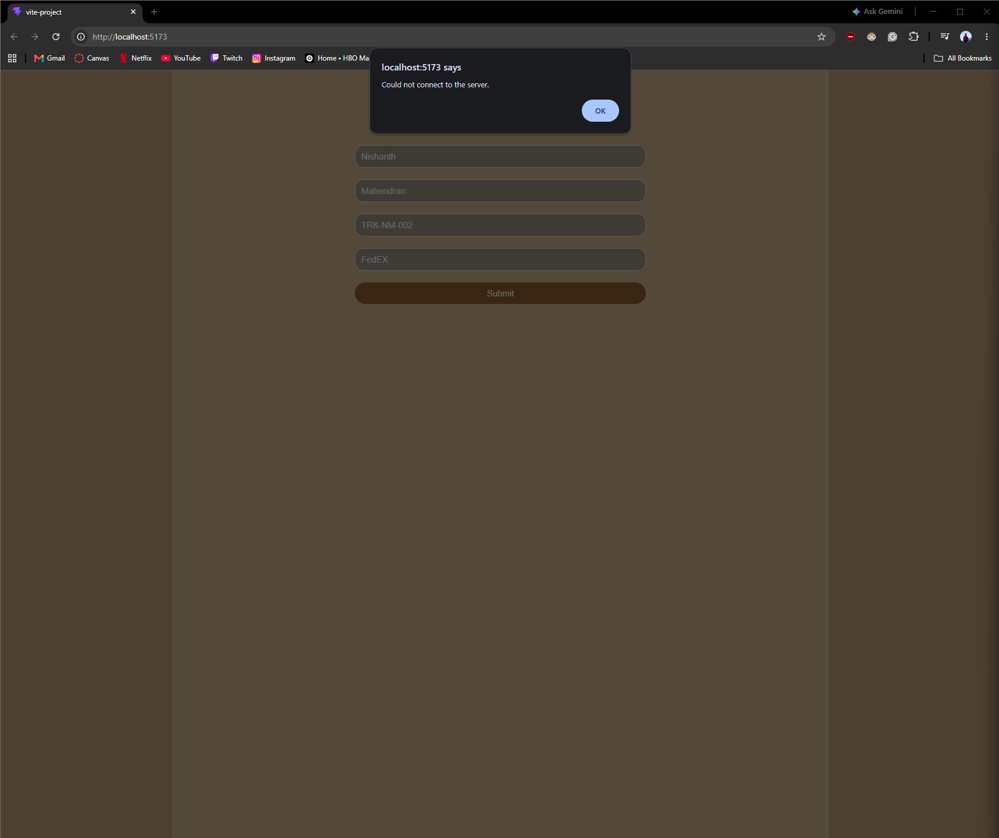
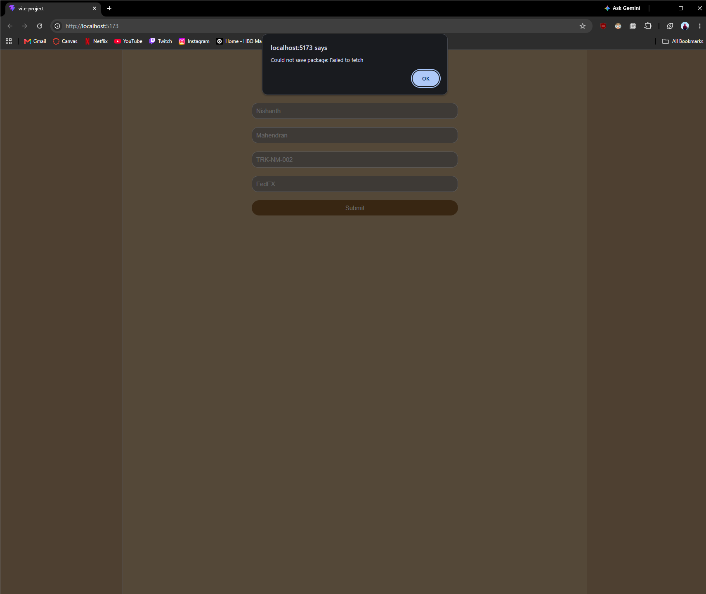
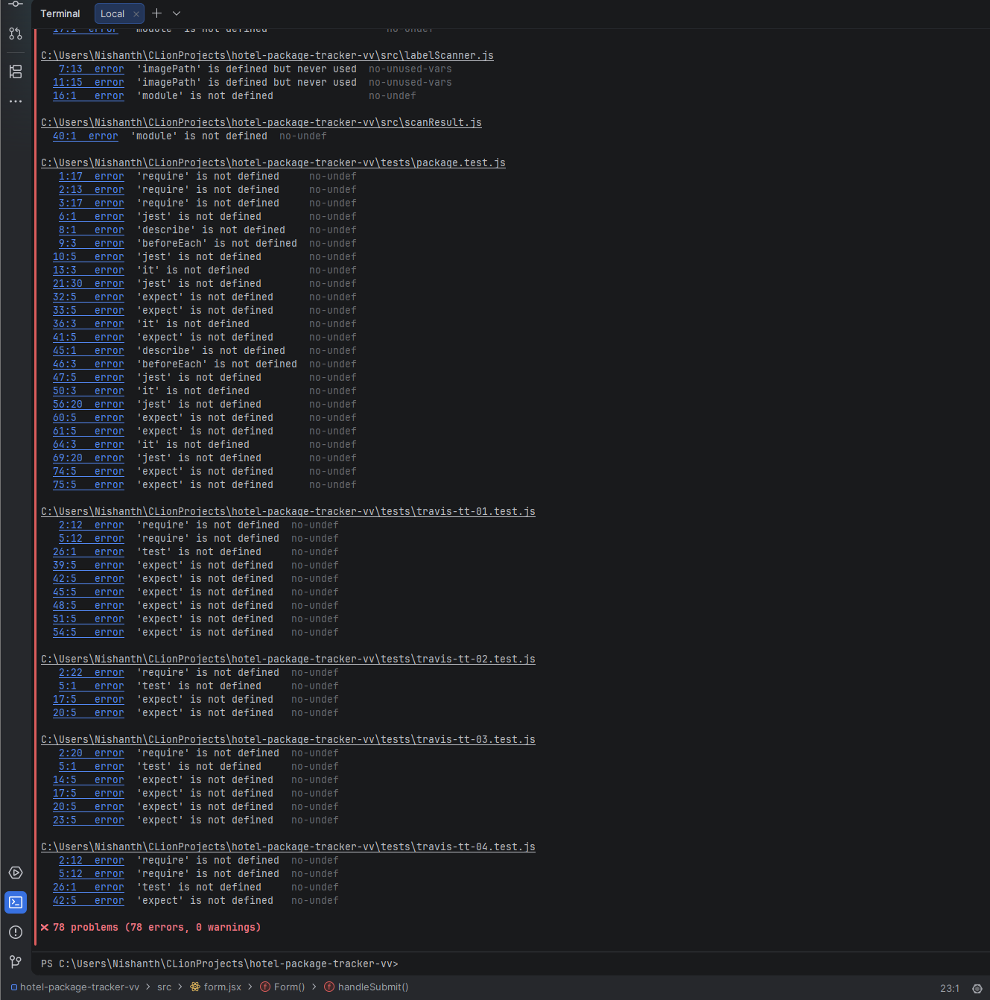
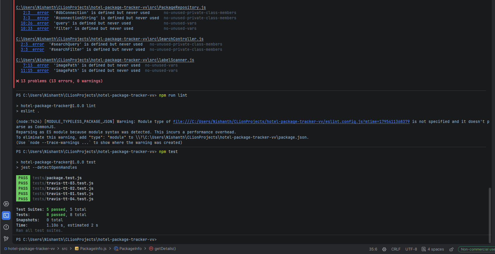

# Nishanth Mahendran

**Team:** Group 15  
**Branches:** `fix/issue-64`, `fix/issue-65`

## Bug Fix 1: Issue #64

- **Issue:** [Issue #64]([https://github.com/carissa-chen/hotel-package-tracker/issues/64])
- **Pull Request:** [PR #88](https://github.com/carissa-chen/hotel-package-tracker/pull/88)
- **Bucket:** Code bu`g

The package form displayed a success message even when the server returned a failed response. I fixed this by checking `response.ok` before showing the success message. Failed saves now display an error instead.

### Screenshots

## Bug Fix 2: Issue #65

- **Issue:** [Issue #65]([https://github.com/carissa-chen/hotel-package-tracker/issues/65])
- **Pull Request:** [PR #92](https://github.com/carissa-chen/hotel-package-tracker/pull/92)
- **Bucket:** Code/configuration bug

The lint command incorrectly treated backend and Jest files as browser files. I updated the ESLint configuration to recognize Node.js and Jest globals and fixed the remaining unused-code errors.

### Screenshots

## AI Disclosure

I used AI to help understand the error messages and identify possible fixes. I reviewed the changes myself, ran the tests and build, and pushed the work through separate pull requests.