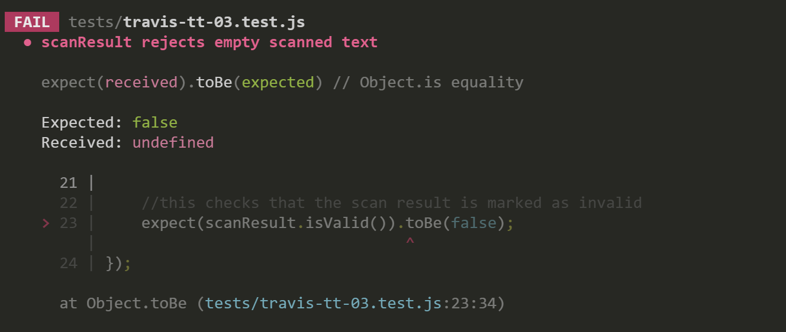
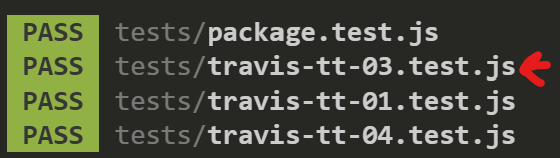
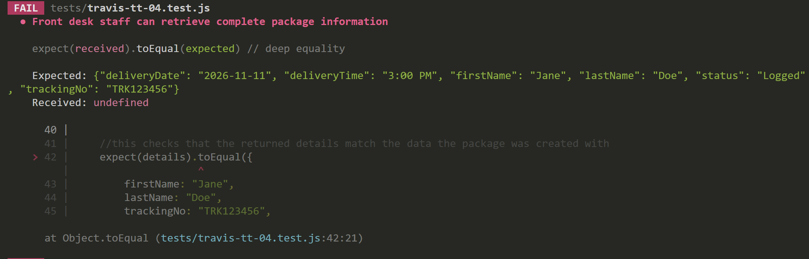
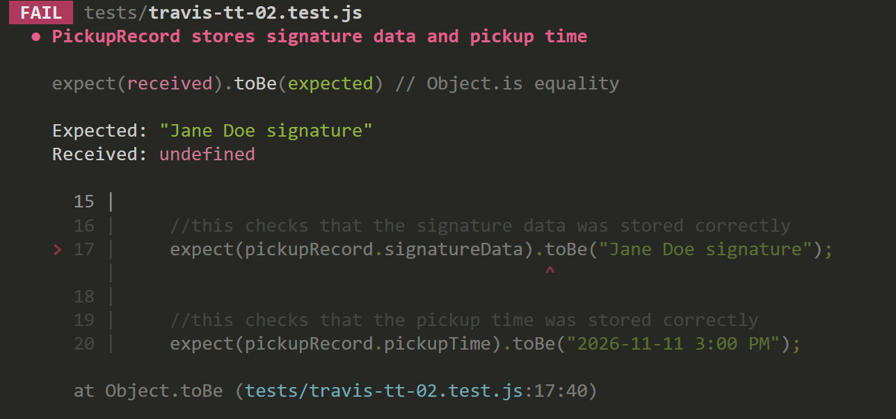
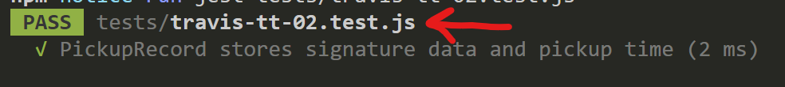

# Travis Trinidad

**Team:** Group 15
**Branch:** `travis`

---

## Bug fix 1: Issue #84, scanResult rejects empty scanned text

- **Issue:** #84 (TT-03)
- **PR:** TODO
- **Test:** `tests/travis-tt-03.test.js`
- **Before:** 
- **After:** 
- **Bucket:** Missing feature. The `parseText` and `isValid` methods are empty `// TODO` bodies, and the README lists this as planned, not built. The instructor confirmed that building a missing feature counts as a fix.

---

## Bug fix 2: Issue #85, PackageInfo returns complete package information

- **Issue:** #85 (TT-04)
- **PR:** TODO
- **Test:** `tests/travis-tt-04.test.js`
- **Before:** 
- **After:** 
- **Bucket:** Missing feature. `getDetails()` is an empty `// TODO` body, and the README lists this as planned, not built. The instructor confirmed that building a missing feature counts as a fix.

---

## Bug fix 3 (optional): Issue #83, PickupRecord stores signature data and pickup time

The assignment requires two fixes per student. This third fix was optional, and I chose to complete it so every one of my tests passes.

- **Issue:** #83 (TT-02)
- **PR:** TODO
- **Test:** `tests/travis-tt-02.test.js`
- **Before:** 
- **After:** 
- **Bucket:** Missing feature. `captureSignature` is an empty `// TODO` body, and the signature and pickup time are private fields with no way to read them back. The instructor confirmed that building a missing feature counts as a fix.

---

## AI disclosure

TODO: 
