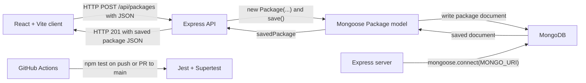

# Trace the Click: System Map

**Team:** Group15  
**Inherited project:** `hotel-package-tracker`  
**User action traced:** Create a package record

## Team and Roles

| Role | Owns | Name |
|---|---|---|
| Product Analyst | Part 1 and questions in Part 4 | Nish |
| Architect | Part 2 and mismatches in Part 4 | Travis |
| Frontend Tracer | Part 3, client side | Matthew |
| Backend Tracer | Part 3, server side | David |

## Part 1: Purpose

This system lets hotel front desk staff log and search guest packages so that package records can be stored digitally and retrieved when guests arrive to pick them up.

The user action we traced is creating a package record. A staff member enters the guest's first name, last name, tracking number, and carrier, then submits the form.

## Part 2: As-Built Architecture

The frontend form is rendered by `src/App.jsx`, which imports `src/form.jsx`. The form sends a POST request to `/api/packages`. The Express application in `app.js` mounts the package router. The route in `routes/packages.js` creates and saves a Mongoose `Package` from `models/Package.js`. The saved package is returned to the frontend as JSON with HTTP status 201.

The server in `server.js` connects to MongoDB before starting the Express server. GitHub Actions runs the Jest and Supertest tests on pushes and pull requests to `main`.

## Part 3: Trace the Click

| Step | Layer | File and function | Data in / data out | Notes or surprises |
|---|---|---|---|---|
| 1 | Frontend | `src/App.jsx` -> `App()` | Renders the `Form` component | The app currently renders one main form. |
| 2 | Frontend | `src/form.jsx` -> `handleSubmit(event)` | Form fields become `packageData` | The guest first and last names are combined into `guestName`. |
| 3 | Frontend | `src/form.jsx` -> `fetch()` | Sends JSON to `POST http://127.0.0.1:5000/api/packages` | The request contains `guestName`, `trackingNumber`, and `carrier`. |
| 4 | API route | `app.js` -> `app.use('/api/packages', packageRoutes)` | Routes the request to the package router | Express parses JSON with `express.json()`. |
| 5 | API route | `routes/packages.js` -> `router.post('/')` | Reads `trackingNumber`, `guestName`, and `carrier` from `req.body` | The route directly validates `trackingNumber` and `guestName`. |
| 6 | Backend logic | `routes/packages.js` -> `new Package({...})` | Creates a Mongoose package object | The model supplies default `status: 'Logged'` and `createdAt`. |
| 7 | Database | `routes/packages.js` -> `newPackage.save()` | Sends the package document to MongoDB | The actual stored model is `models/Package.js`, not `src/PackageInfo.js`. |
| 8 | Response | `routes/packages.js` -> `res.status(201).json(savedPackage)` | Returns the saved package to the client | The response contains the saved package JSON. |
| 9 | Frontend | `src/form.jsx` -> `response.json()` and `alert()` | Reads the response and displays a success alert | The frontend does not check `response.ok` before displaying success. |

## Part 4: Reality Check and Open Questions

### Mismatches between the handoff documents and the running code

1. The log-package sequence diagram shows `PackageInfo.logPackage()` calling `AdditionalPackageInfo.updateAdditionalInfo()`. In the running code, the React form sends `POST /api/packages` to the Express route, which creates and saves a Mongoose `Package`. The methods shown in the sequence diagram are still TODO stubs and are not used by the request path.

2. The class diagram treats `PackageInfo` as the package record, but the record actually saved to MongoDB is defined in `models/Package.js`. The stored model contains `guestName`, `trackingNumber`, `carrier`, `status`, and `createdAt`. The UML `PackageInfo` fields and methods do not describe the stored model.

3. The handoff README describes camera scanning, authentication, room numbers, pickup signatures, package updates, and retrieved-package status. Those features are not implemented in the current React-to-Express request path.

4. The backend route validates `trackingNumber` and `guestName`, but it does not validate `carrier` before saving, even though `carrier` is required by the Mongoose schema.

5. The automated tests mock the Mongoose model, so they do not verify a live MongoDB connection.

### Questions for the original team

1. **Intent:** What was the intent behind running a server instead of storing package data locally?
2. **Design:** Why was a separate field created for specifying the package carrier?
3. **Design:** Why was orange chosen as the primary interface color?

## Part 5: Candidate Requirements

| ID | Candidate requirement | Type | Source | Status | Acceptance criterion |
|---|---|---|---|---|---|
| CR-1 | The system shall create a package record when a user submits a tracking number, guest name, and carrier. | Functional | `src/form.jsx` -> `handleSubmit()`; `routes/packages.js` -> `router.post('/')` | Confirmed | A valid request containing `trackingNumber: "TRK123"`, `guestName: "Jane Doe"`, and `carrier: "FedEx"` returns HTTP 201 and a saved package record. |
| CR-2 | The system shall reject a package request when the tracking number is missing. | Functional | `routes/packages.js` -> `router.post('/')` | Confirmed | A request with `guestName: "Jane Doe"` and `carrier: "FedEx"`, but no tracking number, returns HTTP 400 with a validation error. |
| CR-3 | The system shall retrieve all stored package records. | Functional | `routes/packages.js` -> `router.get('/')` | Confirmed | `GET /api/packages` returns HTTP 200 and an array of package records. |
| CR-4 | The system shall search package records by tracking number or guest name. | Functional | `routes/packages.js` -> `router.get('/search')` | Confirmed | `GET /api/packages/search?q=TRK123` returns packages whose tracking number matches `TRK123`. |
| CR-5 | The system shall reject a package request when the carrier is missing. | Functional | `models/Package.js` requires `carrier`, but `routes/packages.js` does not validate it before saving. | Suspected bug | A request with a tracking number and guest name but an empty carrier returns HTTP 400 instead of a server error or successful record. |
| CR-6 | The system shall allow staff to assign a package to a hotel room. | Functional | `README.md`; `src/AdditionalPackageInfo.js` contains `roomNo`, but the API does not store it. | Unconfirmed | A valid request containing `roomNo: "204"` saves and returns the room number with the package record. |
| CR-7 | The system shall scan a package label and extract the guest name and tracking number. | Functional | `README.md`; `src/labelScanner.js`; `src/scanResult.js` | Unconfirmed | Submitting a valid package-label image returns the extracted guest name and tracking number. |
| CR-8 | The system shall display an error when the API returns a non-success response. | Non-functional (usability) | `src/form.jsx` -> `handleSubmit()` | Suspected bug | If the API returns HTTP 500, the interface displays an error instead of `Package logged successfully!`. |

## Part 6: Three Unit Test Cases

| ID | Requirement | Kind | Unit under test | Input | Expected output | Predicted result today |
|---|---|---|---|---|---|---|
| TC-1 | CR-1 | Positive | `routes/packages.js` -> `router.post('/')` | `{ trackingNumber: "TRK123", guestName: "Jane Doe", carrier: "FedEx" }` | HTTP 201 response containing `trackingNumber: "TRK123"` and `status: "Logged"` | Pass |
| TC-2 | CR-2 | Negative | `routes/packages.js` -> `router.post('/')` | `{ guestName: "Jane Doe", carrier: "FedEx" }` | HTTP 400 response with `Validation Error: trackingNumber and guestName are required.` | Pass |
| TC-3 | CR-5 | Boundary | `routes/packages.js` -> `router.post('/')` | `{ trackingNumber: "TRK123", guestName: "Jane Doe", carrier: "" }` | HTTP 400 response indicating that the carrier is required | Fail: the route does not validate `carrier`; with a live Mongoose model it may return HTTP 500 instead |

## Ownership

- Part 1: Nish
- Part 2: Travis
- Part 3 client side: Matthew
- Part 3 server side: David
- Part 4 mismatches: Travis
- Part 5 candidate requirements: matthew
- Part 6 unit test cases: Nish
